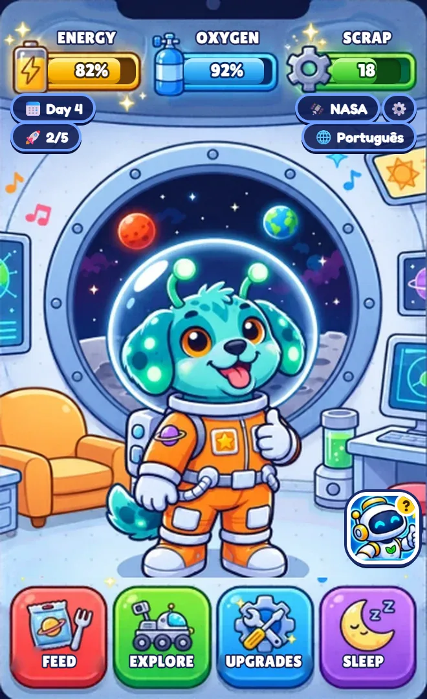
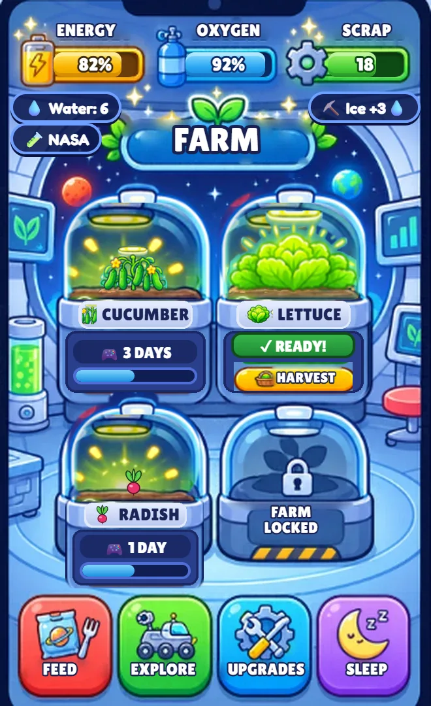
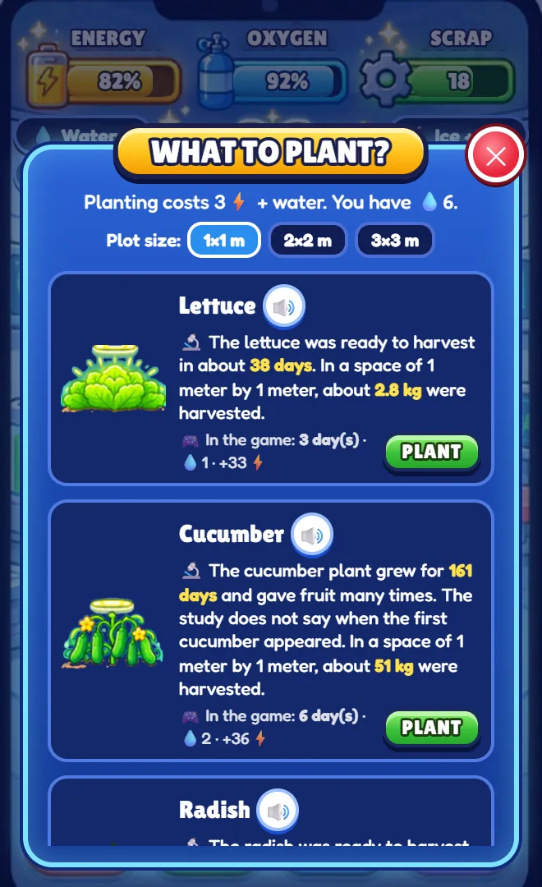
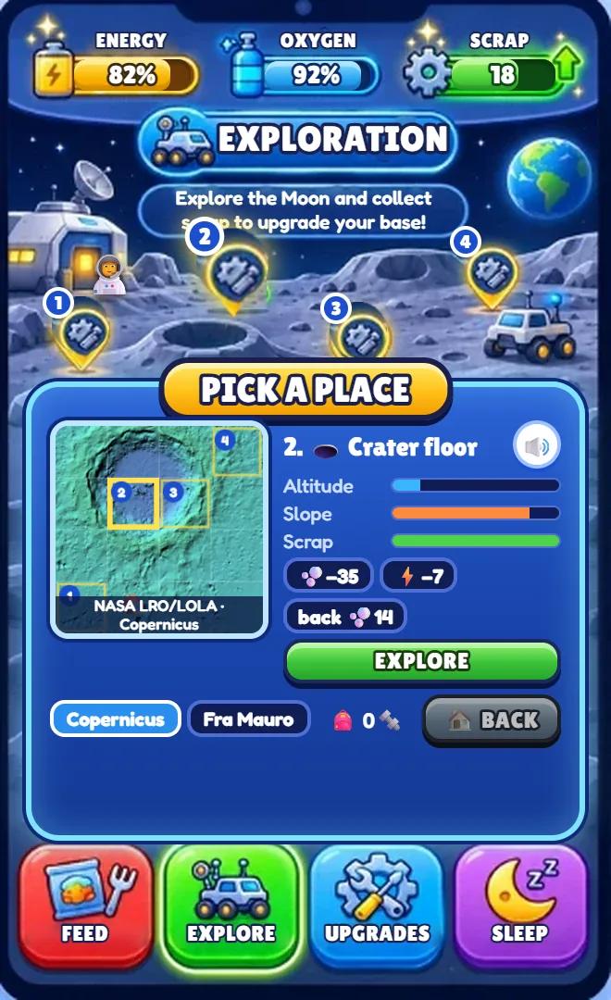
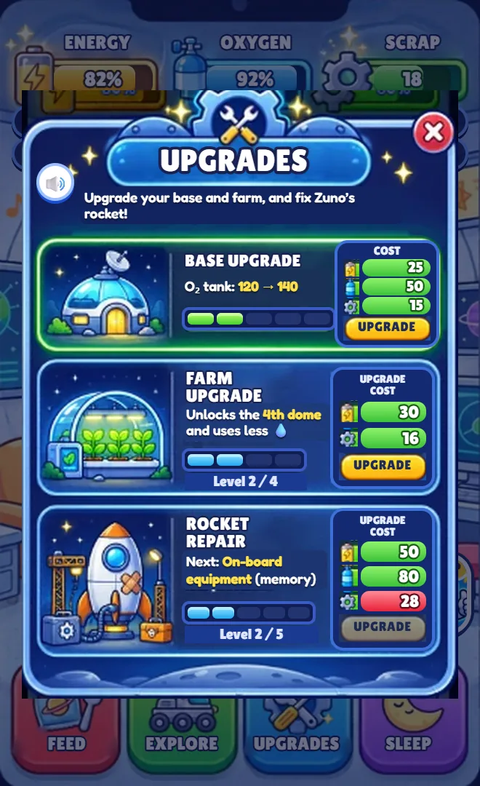
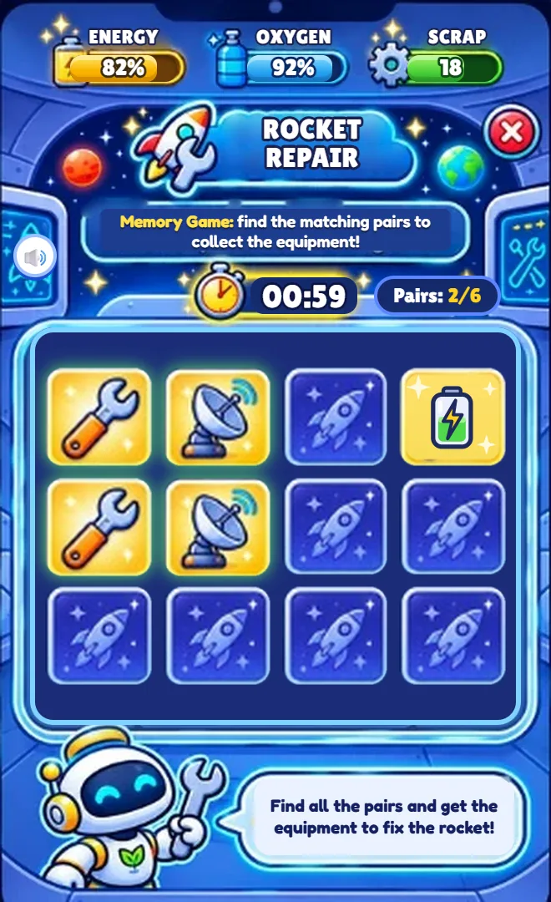
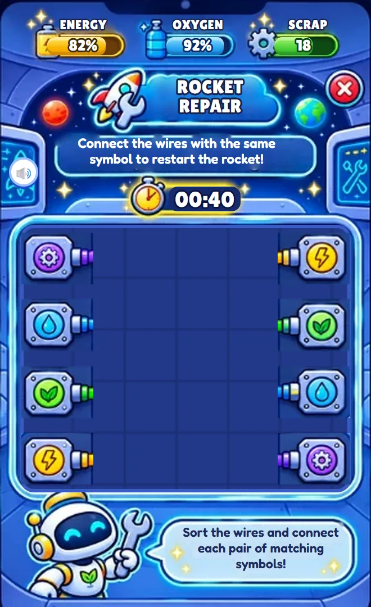
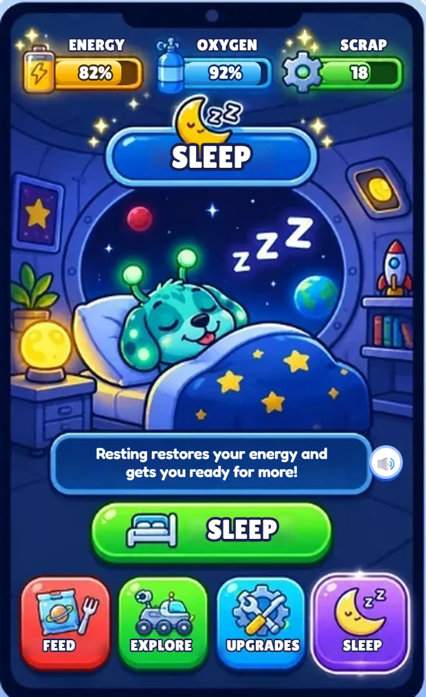

# 🚀 ZUNO — NASA Space Apps Challenge

An educational virtual pet on the Moon for kids aged 7–12, built with **real NASA data**.

**▶ Play now: [lunarcommand.vercel.app](https://lunarcommand.vercel.app/)**

An alien spaceship has crashed near your lunar base. Inside it you find Zuno, a small alien who is hurt and out of energy.
Grow plants to make Elixir for Zuno, explore real places on the Moon to collect scrap, and fix the rocket so Zuno can go home.

<p align="center">
  
  
  
  
</p>
<p align="center">
  
  
  
  
</p>

## Team — Lunar Command
Guilherme Brito · Luis Cabral · Pedro Henrique · Santiago Faé — Caxias do Sul, Brazil

## NASA data used

### NASA OSDR (Open Science Data Repository): farm
**OSD-895: EDEN ISS greenhouse, Antarctica (Earth), 2018**, served through `/api/osd895` (`lib/osd895.js`).

The endpoint `https://osdr.nasa.gov/osdr/data/osd/files/895` only lists the study's files. The server:
1. downloads the ISA metadata ZIP;
2. reads the `s_OSD-895.txt` and `a_OSD-895_*.txt` tables;
3. joins the records by *Sample Name* and checks the units (`day`, `kilogram per square meter`);
4. caches the result (24 h on the local server, 1 day on the Vercel CDN, plus the last copy on the device).

| In the game | Study record | What the child sees |
|---|---|---|
| Lettuce | Lettuce Waldmanns Green (single harvest) | days until harvest + kg harvested in the chosen plot |
| Cucumber | Cucumber Picowell (repeated harvest) | total growing time (not the first fruit) + kg harvested |
| Radish | Radish Raxe (single harvest) | days until harvest + kg harvested in the chosen plot |

- **Estimated yield (kg)** = Mean Edible Freshweight (kg/m²) × plot area (1×1, 2×2 or 3×3 m).
- Missing data shows "We don't have this data yet", never zero or a made-up number.
- The game always says these plants grew in a greenhouse in Antarctica, not on the Moon.
- Game days, water and energy are game balance, kept apart from the science.

### LRO / LOLA (Lunar Reconnaissance Orbiter): exploration
WMTS tiles from **NASA Moon Trek**, served through `/api/lro/{shade|dem}/{z}/{row}/{col}`.
- `LRO_LOLA_DEM_Global_128ppd_v04` (elevation) is read pixel by pixel on a canvas.
- The map is split into 16 zones. For each zone the game computes **mean altitude** and **slope**.
- Slope + distance → oxygen/energy cost. Slope + low altitude → more scrap.
- `LRO_LOLA_ClrShade_Global_128ppd_v04` is the shaded relief shown on the mini map.
- The **4 pins** on the Exploration screen are 4 real zones picked by terrain: near and flat, crater floor, steep rim, and the farthest one.
- Regions: **Copernicus Crater** and **Fra Mauro (Apollo 14 landing site)**.

## Gameplay
- **HUD:** Energy/Elixir (%), Oxygen (%), Scrap (count). Water is shown on the Farm screen.
- **Explore:** costs O₂ and Elixir and puts scrap in your backpack. Going back to the base refills O₂. If O₂ runs out on the way back, the robot rescues you, but half of the backpack is lost.
- **Farm:** Dig ice (−Elixir → +Water) · Plant (−Elixir −Water) · Harvest (→ +Elixir for Zuno).
- **Sleep:** +Elixir (more if you harvested that day), refills O₂, moves ahead 1 day, and plants grow.
- **Upgrades:**
  - Base: 5 levels, oxygen tank 100 → 180.
  - Farm: 4 levels, more domes, less water, bigger harvests.
  - Rocket: 5 parts, each one a minigame: pipes, wires, memory, wires, pipes. The last rocket parts need a bigger tank, so you have to upgrade the Base.
- **Difficulty by age:** 7–8 Beginner, 9–10 Intermediate, 11–12 Advanced.
- **Accessibility:** every text has a 🔊 button (browser text-to-speech in the chosen language), and the robot narrates automatically.
- **Languages:** Portuguese by default. The 🌐 English button (story, age and home screens) or the Parents' area switches to English. In English, the screen art uses `*_en` image versions with the English names drawn on top.
- **Parent Mode** (⚙️, protected by a multiplication question): daily screen-time limit, age, narration, language and restart.
- **Opening video:** every new game starts with `public/assets/intro.mp4` (SKIP button), then the tutorial. After the last rocket repair, `public/assets/ending.mp4` plays before the "Mission complete" screen.

## Run locally
Requires **Node.js 18+** (no dependencies).

```bash
node server.js
```
Open http://localhost:5173. You can also run `npm start`, or double-click `iniciar.bat` on Windows.

> Why a server? The NASA OSDR API only allows CORS from its own domain, so `server.js` acts as a proxy.
> It also keeps the responses in `cache/`, so after the first visit the game works offline.

## Deploy on Vercel
The project is ready to deploy (`vercel.json`): import the repository into Vercel and keep the default settings.
- `public/` is served as a static site (game, art and videos).
- `api/osd895.js`, `api/osdr.js` and `api/lro.js` are serverless functions that proxy NASA at the same paths as the local server. Caching happens on the Vercel CDN.
- `server.js` is only for running on a PC and is excluded from the deploy (`.vercelignore`).

## Files
- `server.js`: static server + NASA proxy/cache.
- `lib/osd895.js`: reads the OSD-895 ISA ZIP (no dependencies).
- `api/`: Vercel serverless functions.
- `public/index.html`, `public/style.css`.
- `public/game.js`: game logic, NASA integration and translations.
- `public/art.js`: the radish and the battery card, drawn in the same style as the screens.
- `public/assets/`:
  - art cut from the original screens: the background of each screen (`bg_*.webp`), popups, buttons, domes, plants, pins, minigame pieces and the robot;
  - the English versions of that art (`*_en`);
  - the videos.
- `design/`: the original screen designs used as the source.
- `docs/images/`: the screenshots in this README.

Each screen uses the original art as its background. Bar values, timers, plants, costs, levels, popup texts, pins and
minigame pieces are dynamic layers placed on top, in 330×540 coordinates (`SCREENS` object in `game.js`).
